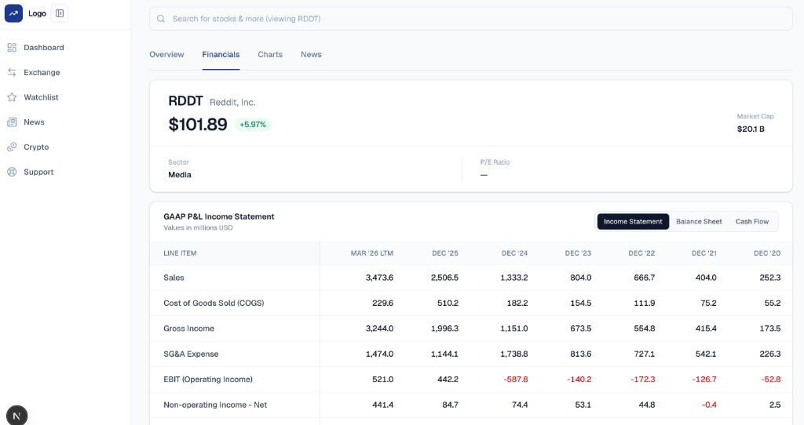

# Investment Platform

A tool that pulls and structures financial data of public equities for fundamental and valuation analysis.

I built it to make company financials and market data easier to search, compare, and reason about in one place; statements, live quotes, and charts instead of jumping between filings and terminals.



## Tech stack

- **Next.js 16** (App Router) and **React 19**
- **TypeScript**
- **Tailwind CSS 4**
- **Supabase** (Postgres + JS client) for historical financials
- **Finnhub** for quotes, company overview, and price history
- **Recharts** for the main price chart
- **Lucide** for icons


## Status and roadmap

**Now:** ticker search, stock overview, historical financials grid, and a price chart backed by Finnhub and Supabase.

**Up next:** finding the right mix of APIs to pull the valuation multiples needed for analysis (without over-fetching or depending on a single vendor).

## How I built it

After designing the format and what information is needed myself, I use Cursor as my coding agent and have been using Claude and Gemini to support me throughout the build.

## Local setup

1. Copy `.env.example` to `.env.local` and fill in your own keys:
  ```
   NEXT_PUBLIC_SUPABASE_URL=
   NEXT_PUBLIC_SUPABASE_ANON_KEY=
   FINNHUB_API_KEY=
  ```
2. Install and run:
  ```bash
   npm install
   npm run dev
  ```
3. Open [http://localhost:3000](http://localhost:3000).

